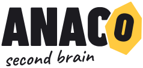
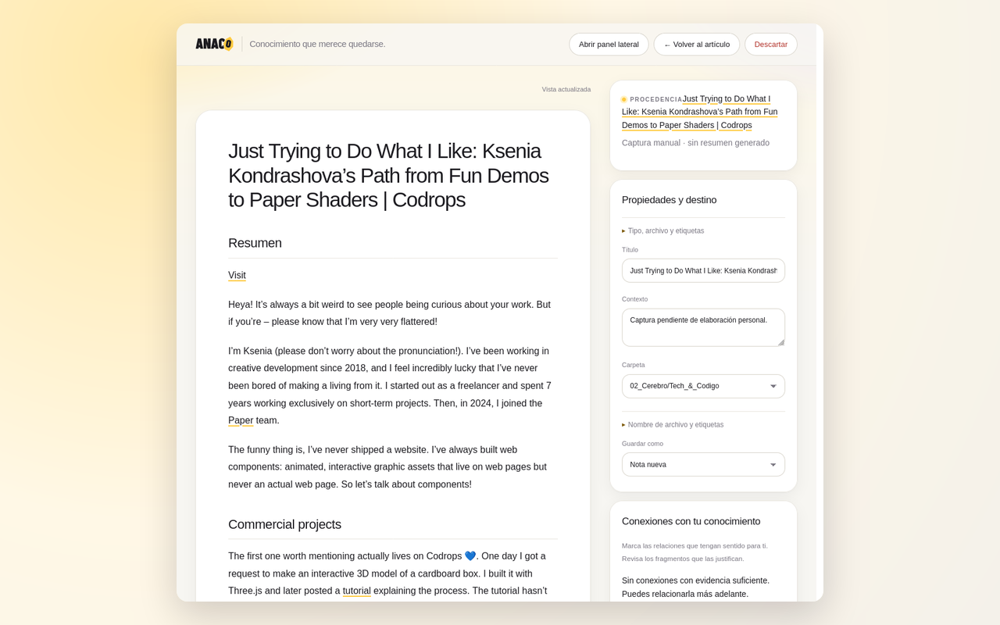
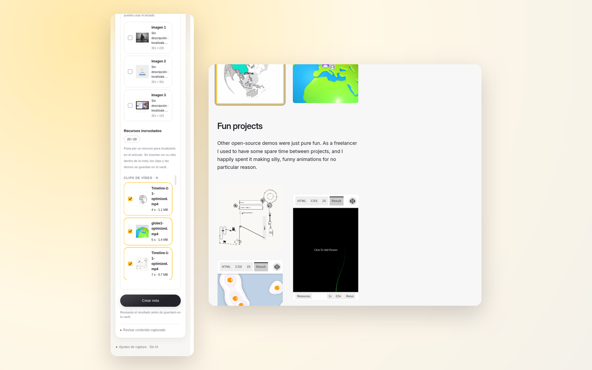
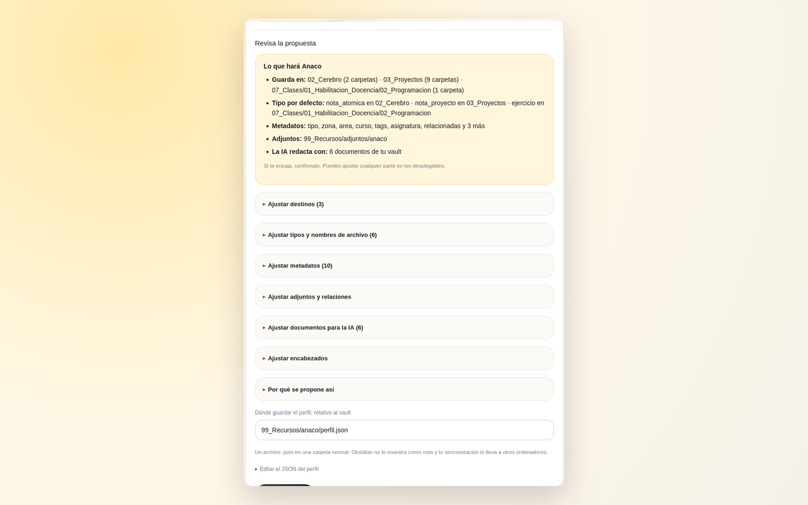
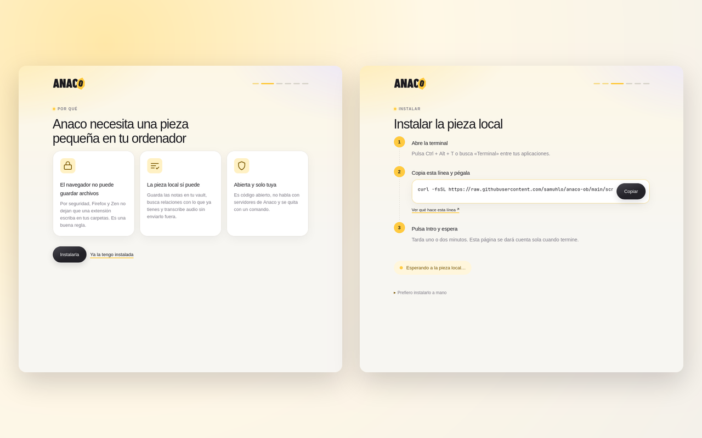

<div align="center">
  <br />
  
  <h1><code>./ANACO.sh</code></h1>

**Captura artículos, cursos, PDF y vídeos desde el navegador y los convierte en notas revisadas para tu vault de Obsidian, con su procedencia, sus recursos y relaciones que puedes comprobar.**
<br /><br />

  
  
  
  <br/>
  
  
  <br/>
  
  
  
  
  <br/><br/>

[Guía de prueba](PRUEBA.md) ·
[Historial](docs/HISTORIAL.md) ·
[Validación](docs/VALIDACION.md) ·
[Notas técnicas](docs/TECNICO.md) ·
[Privacidad](PRIVACY.md)

  <code style="color:#737373;">// anaco: un trozo, una pieza que merece quedarse //</code>

  <br /><br />
</div>

<p align="center">
  
  <br />
  <sub><b>La revisión.</b> La nota a la izquierda; a la derecha, su procedencia, el destino en tu vault y las conexiones con tus notas. Nada se guarda hasta que lo confirmas.</sub>
</p>

---

## // 00_ LA_FRICCIÓN

Guardar lo que aprendes en la web suele acabar en marcadores que no vuelves a abrir o en notas copiadas sin contexto. Un artículo con tuits, demos de CodePen y clips se convierte en un texto plano sin lo que lo hacía útil. Una lección de un curso vive dentro de un visor que no se deja copiar. Y cada vault tiene sus carpetas, sus metadatos y su forma de relacionar notas.

Anaco lee lo que estás viendo, prepara una propuesta de nota que respeta las reglas de tu vault y no escribe nada hasta que la revisas.

---

## // 01_ QUÉ_HACE

| PIEZA | QUÉ ES |
| :--- | :--- |
| **Panel lateral** | Queda vinculado a la pestaña donde lo abres y detecta su contenido: artículo, frase, imagen, PDF, vídeo, lector de un curso o recursos incrustados. Eliges qué incluir. |
| **Recursos incrustados** | Publicaciones de X, demos de CodePen y clips silenciosos. Al pasar el ratón por cada uno, el artículo lo resalta. En la nota aparecen en su sitio. |
| **Revisión** | Una pestaña amplia con la nota, sus propiedades, destino, imágenes y conexiones. Puedes editar, ajustar apartados, dividir en varias notas o integrarlas. |
| **Perfil del vault** | Escanea tu vault y, con tus propias instrucciones, propone dónde guardar, qué tipos y nombres usar y cómo rellenar el frontmatter. Lo confirmas tú. |
| **Servicio local** | Python sin dependencias externas: busca relaciones, llama a la IA, transcribe en local y escribe en el vault solo tras tu revisión. |

<p align="center">
  
  <br />
  <sub><b>Recursos incrustados.</b> El panel lista los clips, demos y publicaciones del artículo; al pasar por uno, el artículo lo rodea en amarillo para que sepas cuál es.</sub>
</p>

---

## // 02_ EL_FLUJO

```text
pestaña → panel: detectar contenido y recursos → elegir imágenes, clips, demos y publicaciones
        → preparar: la IA que elijas o captura manual → revisión: editar, conectar, dividir
        → guardar en el vault según su perfil → volver al artículo
```

La barra de rayitas bajo el logo sigue el avance de la nota: detectada, preparándose, en revisión y guardada.

> _note: nada se escribe en el vault sin pasar por la revisión. las notas existentes solo se amplían con un aporte que apruebas explícitamente._

---

## // 03_ PERFIL_DEL_VAULT

<p align="center">
  
  <br />
  <sub><b>El perfil del vault.</b> Primero, un resumen de lo que hará Anaco con tu vault; debajo, cada regla en su desplegable para ajustarla antes de confirmar.</sub>
</p>

En **Opciones → Perfil del vault** pulsas **Escanear el vault**. Anaco lee carpetas, nombres de archivo y metadatos, nunca el contenido de tus notas. Te enseña qué instrucciones, skills, guías y plantillas ha encontrado para que elijas cuáles puede leer la IA. La propuesta empieza por un resumen de lo que hará; cada regla se ajusta en su desplegable, con la evidencia que la justifica.

El perfil se guarda como `.json` en una carpeta normal del vault, por ejemplo `99_Recursos/anaco/perfil.json`, de modo que viaja con tu sincronización. Si mueves una guía o desaparece un destino, el panel pide **Revisar perfil**.

---

## // 04_ CARACTERÍSTICAS

- **Panel vinculado a su origen**: puedes cambiar de pestaña sin que cambie la captura. Para elegir otra página, pulsa el icono de Anaco en ella o **Usar la pestaña actual**. El lateral sigue visible porque Firefox/Zen lo gestiona por ventana.
- **Enlaces de cursos**: explora el catálogo de módulos de Canvas/AWS Academy y las páginas internas enlazadas. El árbol permite seleccionar módulos completos o lecciones concretas y pasar hasta 100 enlaces a la cola. La exploración conserva la sesión del curso y no prepara notas hasta que lo indiques.
- **Relaciones en bloque**: selecciona o desmarca de una vez las relaciones disponibles de la nota, tanto con notas existentes como entre los temas nuevos.
- **Varios enlaces**: en **Preparar varios enlaces**, pega hasta 100 enlaces, uno por línea. Se procesan de uno en uno en pestañas de segundo plano con la sesión y el contenedor actuales. Puedes pausar después del enlace actual, reintentar los fallidos y abrir cada nota para revisarla. Al reiniciar el navegador, la cola espera a que pulses **Continuar cola**.
- **Cursos y visores**: lee marcos anidados con permisos por dominio, lectores HTML con páginas dibujadas y PDF del visor. El modo **Curso** conserva la detección clásica.
- **Vídeo y audio**: las notas de vídeo incluyen siempre el tag `video`, también las derivadas por temas. Usa subtítulos cuando existen y, si no, transcribe en tu equipo con Whisper. El audio no sale a una API. En YouTube, cada marca `[mm:ss]` de la nota abre el vídeo en ese segundo y los capítulos del vídeo se conservan en la transcripción.
- **Podcasts y entrevistas**: una conversación de YouTube de hasta 4 h se convierte en una nota de fuente con ficha (programa, participantes, duración), resumen, temas con su minuto, ideas clave, consejos, citas y qué llevarte a la práctica. Anaco reconoce si un vídeo es una conversación; el modo **Podcast · entrevista** lo fuerza y la revisión permite prepararlo de nuevo como vídeo normal, o al revés. Cada cita se comprueba palabra a palabra contra la transcripción y se descarta si no aparece.
- **Demos sin conexión**: cada pen de CodePen se guarda como un `index.html` con sus librerías y módulos ES, para verlo en la nota con el plugin HTML Prototype Viewer.
- **Imágenes con criterio**: aprovecha los pies del HTML y solo envía a análisis visual las imágenes que lo necesitan.
- **Relaciones verificables**: cada conexión con una nota existente se apoya en fragmentos literales de ambas notas, y la aceptas o la descartas tú. El enlace lleva a la sección donde está el fragmento (`[[nota#Sección]]`); si la sección no se puede señalar sin ambigüedad, a la nota entera.
- **Una o varias notas**: una nota con apartados, varias enlazadas por temas o que decida la IA, con división e integración revisables.
- **Tu IA**: Codex con tu suscripción de ChatGPT; Claude, Gemini, OpenAI, MiniMax, Qwen u OpenRouter con tu clave, eligiendo el servicio por su nombre; o un modelo local con Ollama o LM Studio, donde nada sale de tu ordenador.
- **Español e inglés**: la interfaz y los mensajes del servicio siguen al navegador o al idioma que elijas en Opciones, y las notas se escriben en el idioma que elijas para ellas. El español es el principal.
- **Privacidad**: sin servidores propios ni telemetría. El vault no se envía completo; la IA recibe la captura y fragmentos de las notas candidatas. Detalle en [PRIVACY.md](PRIVACY.md).

---

## // 05_ STACK

| CAPA | TECNOLOGÍA |
| :--- | :--- |
| **Extensión** | WebExtension Manifest V2 para Zen y Firefox (140+), JavaScript sin framework |
| **Vista previa** | Marked y DOMPurify empaquetados en `extension/vendor/` |
| **Servicio** | Python 3 estándar vía Native Messaging (`org.samuh.anaco_ob`) |
| **IA** | `codex exec` con tu sesión de ChatGPT, o cualquier servicio compatible con OpenAI (Claude, Gemini, OpenAI, MiniMax, Qwen, OpenRouter, Ollama, LM Studio); siempre con salida estructurada |
| **Multimedia** | Poppler, FFmpeg, `yt-dlp` y Faster Whisper en `.media-venv/` |
| **Pruebas** | `node:test`, `unittest` y Selenium sobre Zen real |

---

## // 06_ INICIO_RÁPIDO

Instala [Anaco desde Mozilla Add-ons](https://addons.mozilla.org/addon/anaco/) en Zen o Firefox. Al instalarla se abre la bienvenida, que explica por qué hace falta el servicio local, te da la línea para instalarlo en tu sistema, detecta sola cuándo responde y te deja elegir el vault y la IA. Si algo falta más adelante, el panel lleva de vuelta a ese paso.

<p align="center">
  
  <br />
  <sub><b>El primer uso.</b> La bienvenida explica por qué hace falta la pieza local y da la línea para instalarla; cuando el servicio responde, sigue sola.</sub>
</p>

Después, en **Opciones**, confirma el **Perfil del vault**. Si prefieres la terminal, estos son los mismos pasos:

```bash
# 1. Instala y registra el servicio local; trae Python si no lo tienes
#    (con pipx también vale: pipx install git+https://github.com/samuhlo/anaco-ob && anaco-ob install)
curl -fsSL https://raw.githubusercontent.com/samuhlo/anaco-ob/main/scripts/install.sh | sh
#    En Windows, desde PowerShell:
#    powershell -ExecutionPolicy ByPass -c "irm https://raw.githubusercontent.com/samuhlo/anaco-ob/main/scripts/install.ps1 | iex"

# 2. Comprueba qué falta
anaco-ob doctor

# 3. Opcional: transcripción local con Whisper (PDF y vídeo usan Poppler, FFmpeg y yt-dlp del sistema)
anaco-ob install-media

# 4. Opcional: IA con tu cuenta de ChatGPT; también puedes elegir Claude, Gemini, Qwen…,
#    un modelo local o la captura manual
codex login
```

La guía completa, paso a paso, está en [PRUEBA.md](PRUEBA.md).

| COMANDO | PARA QUÉ |
| :--- | :--- |
| `anaco-ob uninstall [--purge]` | Quitar el registro del navegador; `--purge` borra también los datos locales |
| `python3 scripts/install.py` | Desarrollo: registrar el servicio desde el repositorio y generar `dist/anaco-ob-<versión>.zip` |
| `python3 scripts/i18n.py build` | Regenerar `extension/i18n-catalog.js` tras editar `extension/_locales/*/messages.json`; `check` comprueba que ambos idiomas tienen cada clave |
| `npm run build` | Empaquetar la extensión en `dist/anaco-ob-<versión>.zip` para addons.mozilla.org |
| `npm test` | Pruebas unitarias de la extensión |
| `python3 -m unittest discover -s tests` | Pruebas del servicio |
| `python3 tests/e2e_zen.py --profile` | Recorrido real en Zen: perfil, captura y guardado |
| `python3 tests/e2e_zen.py --readme-shots` | Regenerar las capturas originales en `docs/assets/` (usa la red) |
| `.venv/bin/python scripts/amo_shots.py` | Componer las capturas de 1280×800 de este README y de addons.mozilla.org en `docs/amo/` |

---

## // 07_ BLUEPRINT

```text
extension/     # WebExtension: panel, captura, recursos incrustados, revisión y opciones
native/        # Servicio local: perfil y escaneo del vault, IA, relaciones y guardado
skills/        # Contrato editorial genérico que recibe la IA
scripts/       # Instalación y comprobaciones reproducibles
tests/         # Pruebas unitarias, fixtures y recorridos en Zen
docs/          # Historial, validación, notas técnicas y capturas
```

---

## // 08_ TESTS · DOCS · ESTADO · LICENCIA

- **Estado:** 1.2.3 preparada para pruebas locales; 1.2.0 disponible en [Mozilla Add-ons](https://addons.mozilla.org/addon/anaco/). Los cursos privados se validan en la sesión del usuario; ver [VALIDACION.md](docs/VALIDACION.md).
- **Docs:** [guía de prueba](PRUEBA.md), [historial](docs/HISTORIAL.md), [notas técnicas](docs/TECNICO.md), [contrato editorial de la IA](skills/anaco-ob/SKILL.md) y [publicación en AMO](docs/amo/README.md).
- **Licencia:** [MIT](LICENSE).

---

<div align="center">
<br />

<code>DESIGNED & CODED BY <a href="https://github.com/samuhlo">samuhlo</a></code>

</div>
